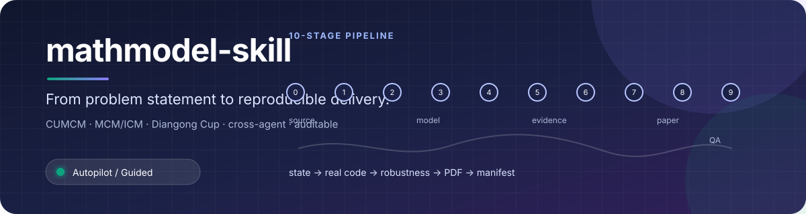
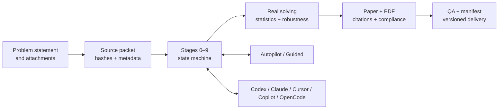

# mathmodel-skill

<div align="center">
  
</div>

<div align="center">

<strong>From a problem statement to a reproducible, reviewable, handoff-ready modelling package.</strong><br/>
<sub>A stateful, evidence-first workflow for CUMCM, MCM/ICM and Diangong Cup teams.</sub>

<br/>

[](./CHANGELOG.md)
[](https://github.com/xu-chenghao413/mathmodel-skill/actions/workflows/ci.yml)
[](https://agentskills.io/)
[](./templates/shared/requirements.txt)
[](./LICENSE)

<a href="#5-minute-quickstart"></a>
<a href="./README.md"></a>

<a href="./README.md">简体中文</a> ·
<a href="#5-minute-quickstart">Quickstart</a> ·
<a href="#supported-clients">Clients</a> ·
<a href="#contributing">Contributing</a>

<br/>
<sub>Autopilot when you want momentum · Guided Mode when you want control</sub>

</div>

> A practical Agent Skill for turning contest work into an inspectable engineering workflow. It does not invent data, results, citations or submission readiness when the evidence is missing.

<div align="center">

| 10 stages | 3 contest families | 5 agent ecosystems | 1 delivery package |
|:---:|:---:|:---:|:---:|
| state-machine driven | CUMCM · MCM/ICM · Diangong Cup | Codex · Claude · Cursor · Copilot · OpenCode | code · results · paper · QA · manifest |

</div>

## Why install it?

<table>
  <tr>
    <td width="33%"><strong>🚀 Keep momentum</strong><br/><sub>Autopilot runs the full route from source packet to delivery. Guided Mode lets the team approve high-impact decisions.</sub></td>
    <td width="33%"><strong>🔬 Keep evidence</strong><br/><sub>Every subproblem follows data → preprocessing → model → result → answer, backed by real executable code.</sub></td>
    <td width="33%"><strong>🔁 Keep context</strong><br/><sub>Decisions, blockers and artifact paths live in <code>state/decision_log.json</code>, so interruptions do not erase progress.</sub></td>
  </tr>
  <tr>
    <td><strong>✅ Keep honest</strong><br/><sub>Mechanical gates catch missing runs, inconsistent algorithm claims, citation gaps, PDF issues and delivery drift.</sub></td>
    <td><strong>🌐 Keep portable</strong><br/><sub>One <code>SKILL.md</code> payload can be installed in Codex, Claude Code, Cursor, VS Code/Copilot, OpenCode and other compatible clients.</sub></td>
    <td><strong>📦 Keep shipping</strong><br/><sub>Outputs are organized into a versioned, hashed package that a teammate can inspect, reproduce and hand off.</sub></td>
  </tr>
</table>

## 5-minute quickstart

Clone the public edition, install the complete runtime payload, and run the offline synthetic-data demo:

```bash
git clone https://github.com/xu-chenghao413/mathmodel-skill.git
cd mathmodel-skill
python scripts/install_skill.py --source . --destination .agents/skills/mathmodel-skill
python examples/quickstart/run_demo.py --output demo-output
```

The demo creates `input/`, `state/`, `analysis/`, `results/` and `qa/manifest.json` with SHA-256 entries. It never writes generated results back into the installed skill directory. See [`examples/quickstart/README.md`](./examples/quickstart/README.md) for the full walkthrough.

<div align="center">

`problem.md` + attachments **→** `decision_log.json` **→** real code + statistics + figures **→** paper + QA + manifest

</div>

## How it works



The ten stages are:

1. Source packet and environment startup
2. Problem comparison and selection
3. Subproblem decomposition and dependency analysis
4. Candidate-model comparison
5. Assumptions, notation and terminology baseline
6. Real executable solving for each subproblem
7. Statistics, sensitivity and robustness
8. Evaluation and generalization
9. Evidence-based paper drafting
10. Blind review, PDF QA and versioned delivery

## Supported clients

The repository follows the `SKILL.md` Agent Skills convention and ships a cross-agent installer. Copy the full directory: references, competition rules, templates and scripts are part of the runtime payload.

| Client | Project-level discovery path | Typical trigger |
|---|---|---|
| Codex CLI / app | `.agents/skills/mathmodel-skill/` | `$mathmodel-skill` or natural language |
| Claude Code | `.claude/skills/mathmodel-skill/` | `/mathmodel-skill` or automatic selection |
| Cursor | `.cursor/skills/mathmodel-skill/` or `.agents/skills/` | `/mathmodel-skill` or Agent selection |
| VS Code + Copilot | `.github/skills/mathmodel-skill/` or `.agents/skills/` | Skills menu or automatic selection |
| OpenCode | `.opencode/skills/mathmodel-skill/` or `.agents/skills/` | `skill` tool or natural language |

Recommended installer examples:

```bash
# Claude Code, Cursor or OpenCode — project scope
python scripts/install_skill.py --source . --agent claude --scope project
python scripts/install_skill.py --source . --agent cursor --scope project
python scripts/install_skill.py --source . --agent opencode --scope project

# Codex — user scope
python scripts/install_skill.py --source . --agent codex --scope user
```

For direct installation, clone the repository into the client’s supported skills directory. Official discovery references are listed in the [Chinese compatibility matrix](./README.md#客户端兼容矩阵).

## What you get

```text
<team-workspace>/
├── input/                  # problem statement and attachment index
├── state/decision_log.json # shared state and recovery source
├── analysis/               # selection, page budget, innovation evidence
├── src/                    # executable solvers and run_all entry point
├── data_raw/ data_processed/
├── results/ figures/       # real outputs and scientific figures
├── paper_workspace/        # sections, BibTeX and AI disclosure
├── paper_output/           # LaTeX, PDF and build logs
├── qa/                     # reproducibility, statistics and delivery audits
└── delivery/<version>/     # hashed, versioned delivery package
```

## Design principles

- **State over memory:** decisions and blockers survive interruption and can be handed across agents.
- **Evidence over narration:** model names never substitute for executable computation and result files.
- **Gates over guesswork:** missing evidence produces an explicit blocker instead of a fake “submission ready” label.
- **Progressive disclosure:** stage-specific references load only when needed, keeping context and maintenance costs bounded.
- **Clean boundaries:** contest rules, papers, datasets, trademarks and external skills keep their own licenses and provenance.

## Optional `nature-*` integrations

The core workflow does not bundle or depend on external `nature-*` skills. If you are authorized to use one, install it independently through your client’s supported skill mechanism; do not copy its source, references or assets into this repository. The Chinese README documents a Codex installer example and the provenance boundary in detail: [`可选安装 nature-* skills`](./README.md#可选安装-nature--skills).

## Provenance, contribution and license

This public edition is maintained by `xu-chenghao413` and is not an official fork or endorsement of any upstream project. It contains substantial original integration, restructuring, validation, templates, state protocols, cross-agent adapters and public-edition documentation. Historical notices remain applicable to the files and components they cover.

- Read [`PROVENANCE.md`](./PROVENANCE.md) for source boundaries and attribution.
- Read [`THIRD_PARTY_NOTICES.md`](./THIRD_PARTY_NOTICES.md) for third-party materials and license scope.
- Read [`CONTRIBUTING.md`](./CONTRIBUTING.md) before opening an issue or pull request.
- Report security issues privately through [`SECURITY.md`](./SECURITY.md).

Unless a file says otherwise, maintainer-authored code, documentation and templates are released under the [MIT License](./LICENSE). MIT does not relicense external skills, contest rules, papers, datasets, fonts, trademarks or other third-party material.

## Development

```bash
python -m unittest discover -s tests -v
python scripts/verify_project.py --check-cli --require-yaml
python scripts/doctor.py
```

See [`CHANGELOG.md`](./CHANGELOG.md) for releases and [`README.md`](./README.md) for the complete Chinese workflow, compliance notes and installation details.
