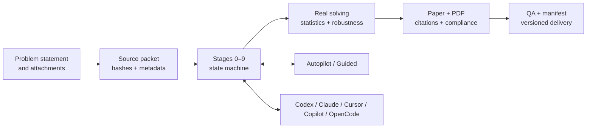

# mathmodel-skill

<div align="center">
  
</div>

<div align="center">

<strong>From a problem statement to a reproducible, reviewable, handoff-ready modelling package.</strong><br/>
<em>A stateful, evidence-first workflow for CUMCM, MCM/ICM and Diangong Cup teams.</em>

<br/>

[](./CHANGELOG.md)
[](https://github.com/xu-chenghao413/mathmodel-skill/actions/workflows/ci.yml)
[](https://agentskills.io/)
[](./pyproject.toml)
[](./LICENSE)

<a href="#5-minute-quickstart"></a>
<a href="./README.md"></a>

<a href="./README.md">简体中文</a> ·
<a href="#5-minute-quickstart">Quickstart</a> ·
<a href="#interactive-entry-points">Interactive paths</a> ·
<a href="#supported-clients">Clients</a> ·
<a href="#contributing">Contributing</a>

<br/>
<em>Autopilot when you want momentum · Guided Mode when you want control</em>

</div>

> A practical Agent Skill for turning contest work into an inspectable engineering workflow. It does not invent data, results, citations or submission readiness when the evidence is missing.

<div align="center">

| 10 stages | 3 contest families | 5 agent ecosystems | 1 delivery package |
|:---:|:---:|:---:|:---:|
| state-machine driven | CUMCM · MCM/ICM · Diangong Cup | Codex · Claude · Cursor · Copilot · OpenCode | code · results · paper · QA · manifest |

</div>

## Why install it?

<table>
  <tr>
    <td width="33%"><strong>🚀 Keep momentum</strong><br/>Autopilot runs the full route from source packet to delivery. Guided Mode lets the team approve high-impact decisions.</td>
    <td width="33%"><strong>🔬 Keep evidence</strong><br/>Every subproblem follows data → preprocessing → model → result → answer, backed by real executable code.</td>
    <td width="33%"><strong>🔁 Keep context</strong><br/>Decisions, blockers and artifact paths live in <code>state/decision_log.json</code>, so interruptions do not erase progress.</td>
  </tr>
  <tr>
    <td><strong>✅ Keep honest</strong><br/>Mechanical gates catch missing runs, inconsistent algorithm claims, citation gaps, PDF issues and delivery drift.</td>
    <td><strong>🌐 Keep portable</strong><br/>One <code>SKILL.md</code> payload can be installed in Codex, Claude Code, Cursor, VS Code/Copilot, OpenCode and other compatible clients.</td>
    <td><strong>📦 Keep shipping</strong><br/>Outputs are organized into a versioned, hashed package that a teammate can inspect, reproduce and hand off.</td>
  </tr>
</table>

## Explore the toolkit

These are executable repository entry points, not just feature labels:

<table>
  <tr>
    <td width="33%"><a href="./scripts/install_skill.py"><strong>🧰 Cross-agent installer</strong></a><br/><code>install_skill.py</code><br/>Safely copy the full runtime payload by client and project/user scope.</td>
    <td width="33%"><a href="./scripts/bootstrap_run.py"><strong>🗺️ Workspace bootstrap</strong></a><br/><code>bootstrap_run.py</code><br/>Create the source packet, state directory, competition route and recovery scene.</td>
    <td width="33%"><a href="./scripts/doctor.py"><strong>🩺 Environment doctor</strong></a><br/><code>doctor.py</code><br/>Check Python, LaTeX, Pandoc, payload integrity and Codex metadata.</td>
  </tr>
  <tr>
    <td><a href="./examples/quickstart/run_demo.py"><strong>🧪 Offline demo</strong></a><br/><code>run_demo.py</code><br/>Generate deterministic results, sensitivity analysis and a hashed manifest.</td>
    <td><a href="./scripts/verify_project.py"><strong>🔍 Release gate</strong></a><br/><code>verify_project.py</code><br/>Check structure, versions, JSON/YAML and public CLI contracts.</td>
    <td><a href="./scripts/validate_delivery.py"><strong>📦 Delivery gate</strong></a><br/><code>validate_delivery.py</code><br/>Cross-check the paper, code, results, QA, citations and ready state.</td>
  </tr>
  <tr>
    <td><a href="./scripts/status.py"><strong>📊 Status panel</strong></a><br/><code>status.py</code><br/>Show the current stage, blockers, mode and machine-readable handoff state.</td>
    <td><a href="./scripts/plan_paper_budget.py"><strong>📐 Page budget</strong></a><br/><code>plan_paper_budget.py</code><br/>Allocate space across the body, abstract and supplement from evidence load.</td>
    <td><a href="./scripts/build_sbom.py"><strong>🧾 SBOM</strong></a><br/><code>build_sbom.py</code><br/>Generate a SHA-256 source-component inventory for release audits.</td>
  </tr>
</table>

See the complete [scripts index](./scripts/README.md) and [maintainer docs](./docs/). Start with the offline demo, then bring the workflow to a real contest problem.

## Interactive entry points

Open the path that matches your goal and copy the prompt or command:

<details>
<summary><strong>① I only want to verify the installation</strong></summary>

```bash
python scripts/doctor.py --skip-tools
python examples/quickstart/run_demo.py --output demo-output
```

This path is fully offline and checks the payload, state directory, generated results, sensitivity analysis and SHA-256 manifest.
</details>

<details>
<summary><strong>② I have a problem statement and attachments — run Autopilot</strong></summary>

```text
Use mathmodel-skill for this mathematical modelling problem and its attachments. Start from the source packet and run the full route: selection, decomposition, model comparison, real executable solving, statistical robustness, paper/PDF, citation checks and the final delivery package. Write every key decision to state/decision_log.json.
```

</details>

<details>
<summary><strong>③ I want to approve every major decision</strong></summary>

```text
Use mathmodel-skill in Guided Mode. At each stage, show candidate approaches, evidence, risks and next-step options, then wait for my confirmation. Do not skip real execution, robustness analysis or blocker logging.
```

</details>

<details>
<summary><strong>④ I already have a paper — run final audit</strong></summary>

```text
Audit this modelling paper for model–code–result consistency, statistics, citations, page budget, anonymity, PDF structure and delivery manifest. Propose only evidence-backed minimal changes and state which issues block a submission-ready result.
```

</details>

<details>
<summary><strong>⑤ I want to choose the contest, mode and plotting backend</strong></summary>

```bash
python scripts/bootstrap_run.py --workspace ./my-contest \
  --mode guided --competition auto --plot-backend python \
  --problem ./problem.pdf --attachment ./data.xlsx
```

Switch `--mode` to `autopilot` for continuous execution. `--competition` accepts `cumcm`, `mcm`, `diangong` or automatic detection.
</details>

<details>
<summary><strong>⑥ I need to resume after an interruption or read machine state</strong></summary>

```bash
python scripts/bootstrap_run.py --workspace ./my-contest --resume \
  --mode autopilot --competition auto
python scripts/doctor.py --workspace ./my-contest --json
```

Resume reads the existing `state/decision_log.json` without replacing team decisions. `--json` makes diagnostics easy to consume from CI, scripts or another agent.
</details>

<details>
<summary><strong>⑦ I want to package the paper, disclosure and SBOM</strong></summary>

```bash
python scripts/render_paper.py --workspace ./my-contest/paper_workspace \
  --output-dir ./my-contest/paper_output
python scripts/build_ai_disclosure.py --log ./my-contest/qa/ai_usage_log.json \
  --output ./my-contest/qa/AI_usage_details.pdf
python scripts/validate_delivery.py --workspace ./my-contest
python scripts/package_delivery.py --workspace ./my-contest
python scripts/build_sbom.py --source . --output ./my-contest/qa/sbom.json \
  --version v7.4.6
```

The last two commands are delivery gates: run them after the paper, code, results and compliance checks are complete. A failed gate preserves blockers instead of fabricating `submission-ready`.
</details>

## Power-user feature panel

The repository is organized as four clickable layers: input → computation → writing → delivery. Every entry below points to a real script or rule file.

<table>
  <tr>
    <td width="25%"><a href="./scripts/bootstrap_run.py"><strong>📥 Input</strong></a><br/>Problem, attachments, hashed source packet and contest routing.</td>
    <td width="25%"><a href="./references/stage_03_model_selection.md"><strong>🧠 Modelling</strong></a><br/>Candidate comparison, rejection logs, assumptions and notation.</td>
    <td width="25%"><a href="./references/stage_06_robustness.md"><strong>📈 Evidence</strong></a><br/>Real solving, statistics, sensitivity, stability intervals and figures.</td>
    <td width="25%"><a href="./scripts/package_delivery.py"><strong>🚢 Delivery</strong></a><br/>Paper/PDF, AI disclosure, anonymity checks, manifest and SBOM.</td>
  </tr>
</table>

<details>
<summary><strong>Show the full advanced pipeline</strong></summary>

```text
source packet
    ↓  bootstrap_run.py
state + decision log
    ↓  stages 0–7
real solvers + statistics + figures
    ↓  render_paper.py / build_ai_disclosure.py
paper + PDF + disclosure
    ↓  validate_delivery.py
versioned delivery + SHA-256 manifest + SBOM
```

</details>

## FAQ

<details>
<summary><strong>Is it limited to Codex?</strong></summary>

No. The core entry point is the standard `SKILL.md`. The public edition documents Codex, Claude Code, Cursor, VS Code/Copilot and OpenCode installation; any compatible agent that follows the directory convention can load it.
</details>

<details>
<summary><strong>Can I use it without LaTeX, Pandoc or external nature skills?</strong></summary>

Yes. The offline demo, state machine, real Python solving, statistics/robustness and most QA checks remain usable. `doctor.py` reports missing optional tools as blockers, and the workflow degrades instead of inventing results.
</details>

<details>
<summary><strong>Are the demo results real contest results?</strong></summary>

No. The demo uses deterministic synthetic data from this repository to verify installation, directories, outputs, sensitivity analysis and hashing. A real contest run must provide the problem statement, attachments and executable solvers.
</details>

<details>
<summary><strong>How do I contribute safely?</strong></summary>

Read [`CONTRIBUTING.md`](./CONTRIBUTING.md), reproduce issues with synthetic data, and do not upload private team material, credentials, unlicensed papers or third-party templates. See [`SUPPORT.md`](./SUPPORT.md) for compatibility and [`SECURITY.md`](./SECURITY.md) for private reports.
</details>

## 5-minute quickstart

Clone the public edition, install the complete runtime payload, and run the offline synthetic-data demo:

```bash
git clone https://github.com/xu-chenghao413/mathmodel-skill.git
cd mathmodel-skill
python scripts/install_skill.py --source . --destination .agents/skills/mathmodel-skill
python examples/quickstart/run_demo.py --output demo-output
```

The demo creates `input/`, `state/`, `analysis/`, `results/` and `qa/manifest.json` with SHA-256 entries. It never writes generated results back into the installed skill directory. See [`examples/quickstart/README.md`](./examples/quickstart/README.md) for the full walkthrough.

<div align="center">

`problem.md` + attachments **→** `decision_log.json` **→** real code + statistics + figures **→** paper + QA + manifest

</div>

## How it works



The ten stages are:

1. Source packet and environment startup
2. Problem comparison and selection
3. Subproblem decomposition and dependency analysis
4. Candidate-model comparison
5. Assumptions, notation and terminology baseline
6. Real executable solving for each subproblem
7. Statistics, sensitivity and robustness
8. Evaluation and generalization
9. Evidence-based paper drafting
10. Blind review, PDF QA and versioned delivery

## Supported clients

The repository follows the `SKILL.md` Agent Skills convention and ships a cross-agent installer. Copy the full directory: references, competition rules, templates and scripts are part of the runtime payload.

| Client | Project-level discovery path | Typical trigger |
|---|---|---|
| Codex CLI / app | `.agents/skills/mathmodel-skill/` | `$mathmodel-skill` or natural language |
| Claude Code | `.claude/skills/mathmodel-skill/` | `/mathmodel-skill` or automatic selection |
| Cursor | `.cursor/skills/mathmodel-skill/` or `.agents/skills/` | `/mathmodel-skill` or Agent selection |
| VS Code + Copilot | `.github/skills/mathmodel-skill/` or `.agents/skills/` | Skills menu or automatic selection |
| OpenCode | `.opencode/skills/mathmodel-skill/` or `.agents/skills/` | `skill` tool or natural language |

Recommended installer examples:

```bash
# Claude Code, Cursor or OpenCode — project scope
python scripts/install_skill.py --source . --agent claude --scope project
python scripts/install_skill.py --source . --agent cursor --scope project
python scripts/install_skill.py --source . --agent opencode --scope project

# Codex — user scope
python scripts/install_skill.py --source . --agent codex --scope user
```

For direct installation, clone the repository into the client’s supported skills directory. Official discovery references are listed in the [Chinese compatibility matrix](./README.md#客户端兼容矩阵).

## What you get

```text
<team-workspace>/
├── input/                  # problem statement and attachment index
├── state/decision_log.json # shared state and recovery source
├── analysis/               # selection, page budget, innovation evidence
├── src/                    # executable solvers and run_all entry point
├── data_raw/ data_processed/
├── results/ figures/       # real outputs and scientific figures
├── paper_workspace/        # sections, BibTeX and AI disclosure
├── paper_output/           # LaTeX, PDF and build logs
├── qa/                     # reproducibility, statistics and delivery audits
└── delivery/<version>/     # hashed, versioned delivery package
```

## Design principles

- **State over memory:** decisions and blockers survive interruption and can be handed across agents.
- **Evidence over narration:** model names never substitute for executable computation and result files.
- **Gates over guesswork:** missing evidence produces an explicit blocker instead of a fake “submission ready” label.
- **Progressive disclosure:** stage-specific references load only when needed, keeping context and maintenance costs bounded.
- **Clean boundaries:** contest rules, papers, datasets, trademarks and external skills keep their own licenses and provenance.

## Optional `nature-*` integrations

The core workflow does not bundle or depend on external `nature-*` skills. If you are authorized to use one, install it independently through your client’s supported skill mechanism; do not copy its source, references or assets into this repository. The Chinese README documents a Codex installer example and the provenance boundary in detail: [`可选安装 nature-* skills`](./README.md#可选安装-nature--skills).

## Provenance, contribution and license

This public edition is maintained by `xu-chenghao413` and is not an official fork or endorsement of any upstream project. It contains substantial original integration, restructuring, validation, templates, state protocols, cross-agent adapters and public-edition documentation. Historical notices remain applicable to the files and components they cover.

- Read [`PROVENANCE.md`](./PROVENANCE.md) for source boundaries and attribution.
- Read [`THIRD_PARTY_NOTICES.md`](./THIRD_PARTY_NOTICES.md) for third-party materials and license scope.
- Read [`CONTRIBUTING.md`](./CONTRIBUTING.md) before opening an issue or pull request.
- Report security issues privately through [`SECURITY.md`](./SECURITY.md).

Unless a file says otherwise, maintainer-authored code, documentation and templates are released under the [MIT License](./LICENSE). MIT does not relicense external skills, contest rules, papers, datasets, fonts, trademarks or other third-party material.

## Token and compute budget

The full workflow uses multi-stage reasoning, real code execution, robustness
analysis, citation checks, paper rendering and blind review. It therefore uses
substantially more context and model calls than a normal one-shot answer. Start
with the offline demo before committing to a complete Autopilot run.

The following are planning ranges for cumulative model input and output tokens,
not billing guarantees. They exclude client-hidden context, PDF/image parsing,
retries, cache effects and external-tool usage. Long statements, large
attachments and additional subproblems can move a run above the range:

| Scope | Typical cumulative range | Suggested strategy |
|---|---:|---|
| Doctor, install smoke test and offline demo | about 1k–5k | Validate the environment first |
| Problem parsing, selection and decomposition | about 5k–20k | Use Guided Mode and confirm before expanding |
| One subproblem: model, executable solve and robustness | about 10k–40k | Run by stage and reuse state/results |
| Full paper, citations, PDF and final audit | about 40k–120k | Start only after the source packet and code are stable |
| Multiple problems, large attachments and blind revisions | often 100k+ | Reserve budget or split the work into tasks |

To control usage, run `doctor.py` and the quickstart first; request only the
current stage and necessary artifacts; prefer section-level patches over full
rewrites; resume from `state/decision_log.json`; and load optional `nature-*`,
citation or reviewer capabilities only when they are needed. Ask for compact
summaries, diffs and next actions instead of repeated full documents. If your
client exposes token telemetry, use that as the source of truth and report
unexpected growth with a sanitized reproduction.

## Contributions welcome

The public workflow is intentionally open to measurable improvements. Useful
contributions include lower token or latency profiles, stronger cross-agent
adapters, evaluation fixtures, competition-rule routing, paper templates and
clearer installation, privacy and provenance boundaries. A pull request is
most useful when it includes a minimal synthetic fixture, validation commands,
compatibility notes and a changelog entry; behavior changes can add a case under
[`evals/`](./evals/).

Please share sanitized failures, performance measurements and design ideas via
issues or pull requests. Read [`CONTRIBUTING.md`](./CONTRIBUTING.md) first, and
never upload problem statements, private data, team identifiers, credentials or
unlicensed third-party material.

## Development

```bash
uv sync --locked --extra dev
uv run python -m unittest discover -s tests -v
uv run python scripts/verify_project.py --check-cli --require-yaml
uv run python scripts/doctor.py
```

See [`CHANGELOG.md`](./CHANGELOG.md) for releases, [`docs/`](./docs/) for maintainer workflows and [`README.md`](./README.md) for the complete Chinese workflow, compliance notes and installation details.
