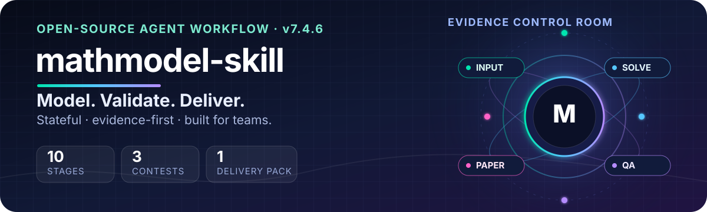
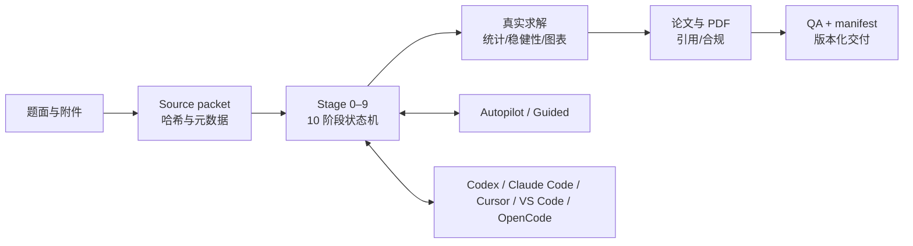

# mathmodel-skill

<div align="center">
  
</div>

<div align="center">

<strong>从一道题，到一套能复现、能审计、能交接的建模交付包。</strong><br/>
<em>From a problem statement to a reproducible, reviewable, handoff-ready modelling package.</em>

<br/>

[](./CHANGELOG.md)
[](https://github.com/xu-chenghao413/mathmodel-skill/actions/workflows/ci.yml)
[](https://agentskills.io/)
[](./pyproject.toml)
[](./LICENSE)

<a href="#5-分钟快速开始"></a>
<a href="./README.en.md"></a>

<a href="./README.en.md">English README</a> ·
<a href="#5-分钟快速开始">5 分钟开始</a> ·
<a href="#交互式上手">交互式上手</a> ·
<a href="#主要能力">能力地图</a> ·
<a href="#安装与快速开始">安装方式</a> ·
<a href="#贡献与社区">参与贡献</a> ·
<a href="./docs/">维护文档</a>

<br/>
<em>Autopilot when you want momentum · Guided Mode when you want control</em>

</div>

面向 CUMCM、MCM/ICM 与电工杯的端到端数学建模竞赛工作流。提供赛题和附件时默认进入 **Autopilot**，连续运行到可验证的交付包；只说“开始建模”或明确要求逐步协作时进入 **Guided Mode**。

> 本项目协助团队组织和核验工作，不保证获奖，也不会在缺少题面、数据或真实运行结果时补造结论。

<div align="center">

| 10 个阶段 | 3 类竞赛 | 5 个 Agent 生态 | 1 个可复现交付包 |
|:---:|:---:|:---:|:---:|
| 状态机驱动 | CUMCM · MCM/ICM · 电工杯 | Codex · Claude · Cursor · Copilot · OpenCode | 代码 · 结果 · 论文 · QA · manifest |

</div>

<table>
  <tr>
    <td align="center" width="33%"><strong>🚀 Autopilot</strong><br/>给出题面和附件，连续推进到可验证交付包。</td>
    <td align="center" width="33%"><strong>🧩 Guided Mode</strong><br/>在选题、模型、稳健性和论文节点逐步确认。</td>
    <td align="center" width="33%"><strong>🔁 Resume anywhere</strong><br/>用状态日志在中断后恢复，也可跨 Agent 接力。</td>
  </tr>
</table>

## 可直接体验的工具箱

这些不是概念性模块，而是仓库里可以直接运行的入口：

<table>
  <tr>
    <td width="33%"><a href="./scripts/install_skill.py"><strong>🧰 跨 Agent 安装</strong></a><br/><code>install_skill.py</code><br/>按客户端与 project/user scope 安全复制完整运行时。</td>
    <td width="33%"><a href="./scripts/bootstrap_run.py"><strong>🗺️ 工作区初始化</strong></a><br/><code>bootstrap_run.py</code><br/>建立 source packet、状态目录、竞赛路由与恢复现场。</td>
    <td width="33%"><a href="./scripts/doctor.py"><strong>🩺 环境诊断</strong></a><br/><code>doctor.py</code><br/>检查 Python、LaTeX、Pandoc、payload 和 Codex 元数据。</td>
  </tr>
  <tr>
    <td><a href="./examples/quickstart/run_demo.py"><strong>🧪 离线 Demo</strong></a><br/><code>run_demo.py</code><br/>用确定性合成数据生成结果、灵敏度分析和哈希清单。</td>
    <td><a href="./scripts/verify_project.py"><strong>🔍 发布前校验</strong></a><br/><code>verify_project.py</code><br/>检查目录、版本、JSON/YAML 与公共 CLI。</td>
    <td><a href="./scripts/validate_delivery.py"><strong>📦 交付机械门</strong></a><br/><code>validate_delivery.py</code><br/>核对论文、代码、结果、QA、引用和 submission-ready 状态。</td>
  </tr>
  <tr>
    <td><a href="./scripts/status.py"><strong>📊 状态面板</strong></a><br/><code>status.py</code><br/>查看当前阶段、blocker、模式和机器可读交接状态。</td>
    <td><a href="./scripts/plan_paper_budget.py"><strong>📐 页数预算</strong></a><br/><code>plan_paper_budget.py</code><br/>按证据负担规划正文、摘要与附录空间。</td>
    <td><a href="./scripts/build_sbom.py"><strong>🧾 SBOM 清单</strong></a><br/><code>build_sbom.py</code><br/>生成带 SHA-256 的源码组件清单，便于发布审计。</td>
  </tr>
</table>

完整脚本索引见 [`scripts/README.md`](./scripts/README.md)，维护者入口见 [`docs/`](./docs/)，建议先运行离线 Demo，再接入真实赛题。

## 交互式上手

点击与你的目标匹配的入口，直接复制对应 Prompt：

<details>
<summary><strong>① 我只想先验证安装是否正常</strong></summary>

```bash
python scripts/doctor.py --skip-tools
python examples/quickstart/run_demo.py --output demo-output
```

这条路径完全离线，适合先检查 payload、状态目录、结果文件、灵敏度分析和 SHA-256 manifest。
</details>

<details>
<summary><strong>② 我有题面和附件，直接进入 Autopilot</strong></summary>

```text
这是我的数学建模赛题和附件。请使用 mathmodel-skill，从 source packet 开始自动推进：完成选题、问题拆解、模型比较、真实代码求解、统计稳健性、论文/PDF、引用核验和最终交付包；所有关键决策写入 state/decision_log.json。
```

</details>

<details>
<summary><strong>③ 我希望每一步都由我确认</strong></summary>

```text
请使用 mathmodel-skill 的 Guided Mode。每个阶段先给出候选方案、证据、风险和下一步选项，等我确认后再继续；不要跳过真实运行、稳健性分析或 blocker 记录。
```

</details>

<details>
<summary><strong>④ 我已有论文，只做终审与交付检查</strong></summary>

```text
请审计这份数学建模论文的模型—代码—结果一致性、统计、引用、页数、匿名、PDF 结构和交付 manifest；只提出有证据支持的最小修改，并明确哪些问题会阻止 submission-ready。
```

</details>

<details>
<summary><strong>⑤ 我想自定义竞赛、模式与绘图后端</strong></summary>

```bash
python scripts/bootstrap_run.py --workspace ./my-contest \
  --mode guided --competition auto --plot-backend python \
  --problem ./problem.pdf --attachment ./data.xlsx
```

把 `--mode` 换成 `autopilot` 可连续推进；`--competition` 支持 `cumcm`、`mcm`、`diangong` 或自动识别。
</details>

<details>
<summary><strong>⑥ 我想在中断后恢复，或只查看机器可读状态</strong></summary>

```bash
python scripts/bootstrap_run.py --workspace ./my-contest --resume \
  --mode autopilot --competition auto
python scripts/doctor.py --workspace ./my-contest --json
```

恢复只读取现有 `state/decision_log.json`，不会覆盖团队已经做出的决策；`--json` 方便 CI、脚本或其他 Agent 消费检查结果。
</details>

<details>
<summary><strong>⑦ 我想把论文、披露与 SBOM 一起打包</strong></summary>

```bash
python scripts/render_paper.py --workspace ./my-contest/paper_workspace \
  --output-dir ./my-contest/paper_output
python scripts/build_ai_disclosure.py --log ./my-contest/qa/ai_usage_log.json \
  --output ./my-contest/qa/AI工具使用详情.pdf
python scripts/validate_delivery.py --workspace ./my-contest
python scripts/package_delivery.py --workspace ./my-contest
python scripts/build_sbom.py --source . --output ./my-contest/qa/sbom.json \
  --version v7.4.6
```

最后两个命令是交付门：只在论文、代码、结果和合规检查完成后运行；校验失败会保留 blocker，不会伪造 `submission-ready`。
</details>

<details>
<summary><strong>目录导航</strong></summary>

- [5 分钟快速开始](#5-分钟快速开始)
- [为什么值得关注](#为什么值得关注)
- [可直接体验的工具箱](#可直接体验的工具箱)
- [交互式上手](#交互式上手)
- [功能面板](#功能面板)
- [常见问题](#常见问题)
- [主要能力](#主要能力)
- [工程架构](#工程架构)
- [支持范围](#支持范围)
- [安装与快速开始](#安装与快速开始)
- [工程设计亮点](#工程设计亮点)
- [贡献与社区](#贡献与社区)
- [开发与验证](#开发与验证)
- [数据、来源与隐私边界](#数据来源与隐私边界)
- [License](#license)

</details>

## 功能面板

把仓库能力按“输入 → 计算 → 写作 → 交付”拆成可点击的四层；每个入口都对应真实脚本或规则文件。

<table>
  <tr>
    <td width="25%"><a href="./scripts/bootstrap_run.py"><strong>📥 输入层</strong></a><br/>题面、附件、哈希 source packet 与竞赛路由。</td>
    <td width="25%"><a href="./references/stage_03_model_selection.md"><strong>🧠 建模层</strong></a><br/>候选模型比较、拒绝记录、假设与符号基线。</td>
    <td width="25%"><a href="./references/stage_06_robustness.md"><strong>📈 证据层</strong></a><br/>真实求解、统计、敏感性、稳健区间和科研图表。</td>
    <td width="25%"><a href="./scripts/package_delivery.py"><strong>🚢 交付层</strong></a><br/>论文/PDF、AI 披露、匿名检查、manifest 与 SBOM。</td>
  </tr>
</table>

<details>
<summary><strong>查看一条完整的高级流水线</strong></summary>

```text
source packet
    ↓  bootstrap_run.py
state + decision log
    ↓  stage 0–7
real solvers + statistics + figures
    ↓  render_paper.py / build_ai_disclosure.py
paper + PDF + disclosure
    ↓  validate_delivery.py
versioned delivery + SHA-256 manifest + SBOM
```

</details>

## 常见问题

<details>
<summary><strong>它只能在 Codex 里用吗？</strong></summary>

不是。核心入口是标准 `SKILL.md`，公开版提供 Codex、Claude Code、Cursor、VS Code/Copilot、OpenCode 的安装路径；其他兼容 Agent 只要支持该目录约定，也可以手动放入其 skills 目录。
</details>

<details>
<summary><strong>没有 LaTeX、Pandoc 或外部 nature skills 还能用吗？</strong></summary>

可以。离线 Demo、状态机、真实 Python 求解、统计/稳健性和多数 QA 不依赖它们；缺少可选工具时，`doctor.py` 会报告 blocker，工作流会降级而不是补造结果。
</details>

<details>
<summary><strong>Demo 的结果是真实竞赛结果吗？</strong></summary>

不是。Demo 只使用仓库内确定性的合成数据，用来验证安装、目录、结果、灵敏度分析和哈希清单；真实竞赛必须提供题面、附件并运行真实求解代码。
</details>

<details>
<summary><strong>如何安全地贡献？</strong></summary>

先读 [`CONTRIBUTING.md`](./CONTRIBUTING.md)，用合成数据复现问题，不要提交私人队伍材料、凭据、未授权论文或第三方模板；安全问题请走 [`SECURITY.md`](./SECURITY.md) 的私下渠道。
</details>

## 5 分钟快速开始

先克隆公开版并安装完整运行时 payload：

```bash
git clone https://github.com/xu-chenghao413/mathmodel-skill.git
cd mathmodel-skill
python scripts/install_skill.py --source . --destination .agents/skills/mathmodel-skill
```

然后运行一个完全离线、只含合成数据的端到端示例：

```bash
python examples/quickstart/run_demo.py --output demo-output
```

示例会生成 `input/`、`state/`、`analysis/`、`results/`（含分配表、灵敏度表和 SVG 图）和带 SHA-256 清单的 `qa/manifest.json`；它不会把结果写回 skill 安装目录。完整说明见 [`examples/quickstart/README.md`](./examples/quickstart/README.md)。安装后，在支持 Agent Skills 的客户端中重新加载 skill，并提供题面和附件即可开始真实竞赛工作流。

<table>
  <tr>
    <td><strong>输入</strong><br/><code>problem.md</code> + 附件</td>
    <td>→</td>
    <td><strong>状态</strong><br/><code>decision_log.json</code></td>
    <td>→</td>
    <td><strong>证据</strong><br/>代码 · 统计 · 图表</td>
    <td>→</td>
    <td><strong>交付</strong><br/>论文 · QA · manifest</td>
  </tr>
</table>

## 为什么值得关注

这不是一组一次性提示词，而是一个带有状态、脚本、模板、规则包和回归测试的 Agent Skill：

<table>
  <tr>
    <td width="50%"><strong>🧭 状态化</strong><br/>关键决策、评分、阻塞项和产物定位写入 <code>state/decision_log.json</code>，中断后可以从现场恢复。</td>
    <td width="50%"><strong>🔬 证据化</strong><br/>每个子问题都沿着“数据 → 预处理 → 模型 → 结果 → 回题结论”建立证据链，不用模型名称代替真实计算。</td>
  </tr>
  <tr>
    <td><strong>✅ 可验证</strong><br/>真实 Python 求解、统计/灵敏度、算法声明一致性、LaTeX/PDF QA 和最终交付机械门彼此衔接。</td>
    <td><strong>🌐 跨 Agent</strong><br/>标准 <code>SKILL.md</code> 入口可被 Codex、Claude Code、Cursor、VS Code/Copilot、OpenCode 或其他兼容客户端加载。</td>
  </tr>
  <tr>
    <td><strong>🧾 可审计</strong><br/>保留 provenance、AI 使用记录、匿名检查、引用核验和版本化 delivery manifest，方便复盘与持续维护。</td>
    <td><strong>📦 可交付</strong><br/>从题面、代码和结果一路组织到论文/PDF、QA 报告与带哈希的版本化交付目录。</td>
  </tr>
</table>

## 公开版定位与贡献

本仓库由 `xu-chenghao413` 维护。它不是任何上游仓库的官方分支，也不代表上游作者或 Nature Portfolio 的背书。

### 公开版贡献者

- `xu-chenghao413`：公开版当前维护者；负责公开版新增实现、重构、清理、测试和发布维护。

这里的“贡献者”仅指本公开版新增、重构和维护范围，不替代历史许可证、来源说明或 Git 提交记录中的作者信息。

本公开版以早期数学建模工作流为历史来源之一，吸收了独立安装的 `nature-*` skills 在证据链、统计、科研绘图、学术写作和审稿方面的通用方法，并进行了大幅重构。`xu-chenghao413` 在本公开版中负责并持续维护：

- Autopilot / Guided 双模式、10 阶段状态机、可恢复的 `decision_log.json` 和跨 harness 接力协议；
- CUMCM、MCM/ICM、电工杯三类竞赛路由、规则基线、评分覆盖层、模板装配和提交前合规门；
- 真实代码求解、统计与稳健性检查、section-level 回修、PDF/LaTeX QA、版本化交付和回归测试；
- 公开版的 clean-room 文档、原创装配模板、来源边界、AI 使用披露和隐私/第三方材料隔离策略；
- 将上述模块整合为可安装的跨 Agent Skill，并保留 Codex plugin shim、Claude Code/Cursor/OpenCode 目录适配和同一套工作流入口。

因此，当前版本是一个有明确新增实现和重构贡献的衍生公开版，而不是对任何单一 skill 的原样转载。历史文件若保留上游版权通知，详见 [`LICENSE`](./LICENSE)、[`PROVENANCE.md`](./PROVENANCE.md) 和 [`THIRD_PARTY_NOTICES.md`](./THIRD_PARTY_NOTICES.md)。

## 主要能力

- 三类竞赛共用状态协议，并按竞赛加载规则、模板和评分覆盖层。
- `fast`、`standard`、`championship` 三种分析深度，与 Autopilot/Guided 独立组合。
- 每个子问题形成 `数据 → 预处理 → 模型 → 结果 → 回题结论` 的可复现链路。
- 自适应正文页预算、创新证据账本及算法名称—定义—代码—日志—结果一致性检查。
- CUMCM AI 使用记录、匿名检查、PDF 视觉 QA、交付清单和版本化打包。
- 可选调用分别安装的文献、统计、科研绘图、写作和审稿 skills；缺少这些扩展时核心流程仍可运行。

## 工程架构



### 核心模块与可观察产物

| 工程问题 | 实现 | 可检查产物 |
|---|---|---|
| 长流程容易丢上下文 | `decision_log.json` + 恢复协议 | `state/decision_log.json` |
| 模型选择缺少证据 | 候选模型比较、拒绝记录、反事实反馈 | Stage 3 评分与 rejection log |
| “写了模型但没跑代码” | 真实代码求解和结果回题硬门 | `src/`、`results/`、QA 摘要 |
| 论文超页或格式漂移 | 自适应页预算、section marker、PDF 结构检查 | `analysis/page_budget.json`、`paper_output/` |
| AI 产物难以复核 | 关键事件级 AI 台账和人工核验字段 | `qa/ai_usage_log.json`、披露 PDF |
| 交付物散落且不可复现 | 单文件夹打包、哈希、manifest、阻塞状态 | `delivery/<version>/` |

## 支持范围

| 竞赛 | 默认时长 | 语言 | LaTeX 基线 | 经验数据状态 |
|---|---:|---|---|---|
| CUMCM | 72 h | 中文 | XeLaTeX / 本项目原创 `ctexart` 装配模板 | 91 份来源文档的聚合统计，其中 59 份成功文本提取 |
| MCM/ICM | 96 h | English | pdfLaTeX / `article` | `seed v0.1`，不宣称论文样本分位 |
| 电工杯 | 72 h | 中文 | XeLaTeX / `ctexart` | `seed v0.1`，不宣称论文样本分位 |

当届题面、官方通知和用户明确要求始终优先于仓库内的历史基线。

## 安装与快速开始

本项目遵循以 `SKILL.md` 为入口的 Agent Skills 目录约定。完整复制 skill 目录很重要：`SKILL.md` 会按需读取 `references/`、`competitions/`、`templates/` 和 `scripts/`，只复制一个 Markdown 文件会失去关键能力。

### 客户端兼容矩阵

| Agent / 客户端 | 项目级目录 | 用户级目录 | 触发方式 |
|---|---|---|---|
| Codex CLI / Codex app | `.agents/skills/mathmodel-skill/` | `~/.agents/skills/mathmodel-skill/` | `$mathmodel-skill` 或自然语言 |
| Claude Code | `.claude/skills/mathmodel-skill/` | `~/.claude/skills/mathmodel-skill/` | `/mathmodel-skill` 或自动触发 |
| Cursor | `.cursor/skills/mathmodel-skill/` 或 `.agents/skills/` | `~/.cursor/skills/` 或 `~/.agents/skills/` | `/mathmodel-skill` 或 Agent 自动选择 |
| VS Code + GitHub Copilot | `.github/skills/mathmodel-skill/`、`.claude/skills/` 或 `.agents/skills/` | `~/.copilot/skills/`、`~/.claude/skills/` 或 `~/.agents/skills/` | `/skills` 菜单或自动选择 |
| OpenCode | `.opencode/skills/mathmodel-skill/` 或 `.agents/skills/` | `~/.config/opencode/skills/` 或 `~/.agents/skills/` | `skill` 工具或自然语言 |
| 其他兼容客户端 | 该客户端的项目 skills 目录 | 该客户端的用户 skills 目录 | 读取 `SKILL.md` 后按其命令约定触发 |

上述目录是客户端的发现位置，不是本项目自定义的强制配置。不同客户端的官方说明： [Codex / ChatGPT Skills](https://learn.chatgpt.com/docs/build-skills)、[Claude Code Skills](https://code.claude.com/docs/en/skills)、[Cursor Agent Skills](https://cursor.com/docs/skills)、[VS Code Agent Skills](https://code.visualstudio.com/docs/agent-customization/agent-skills)、[OpenCode Skills](https://opencode.ai/docs/skills)。

### 方式 A：用跨 Agent 安装脚本（推荐）

先把仓库克隆到一个独立的 checkout，再让脚本把运行时 payload 安全复制到目标项目或用户目录。脚本默认拒绝覆盖已有目录，并排除 `.git`、CI、测试和生成中的用户工作区：

```bash
git clone https://github.com/xu-chenghao413/mathmodel-skill.git /tmp/mathmodel-skill
cd <your-team-workspace>

# 项目级安装
python /tmp/mathmodel-skill/scripts/install_skill.py --source /tmp/mathmodel-skill --agent claude --scope project
python /tmp/mathmodel-skill/scripts/install_skill.py --source /tmp/mathmodel-skill --agent cursor --scope project
python /tmp/mathmodel-skill/scripts/install_skill.py --source /tmp/mathmodel-skill --agent opencode --scope project

# 用户级安装
python /tmp/mathmodel-skill/scripts/install_skill.py --source /tmp/mathmodel-skill --agent codex --scope user
```

也可以显式指定目录：

```bash
python /tmp/mathmodel-skill/scripts/install_skill.py \
  --source /tmp/mathmodel-skill \
  --destination /path/to/your-agent/skills/mathmodel-skill
```

Windows PowerShell：

```powershell
py "C:\path\to\mathmodel-skill\scripts\install_skill.py" `
  --source "C:\path\to\mathmodel-skill" `
  --agent claude --scope project
py "C:\path\to\mathmodel-skill\scripts\install_skill.py" `
  --source "C:\path\to\mathmodel-skill" `
  --agent copilot --scope user
```

### 方式 B：直接 clone 到客户端目录

把下面的 `<skill-root>` 替换成上表中某个客户端的项目级或用户级路径：

```bash
git clone https://github.com/xu-chenghao413/mathmodel-skill.git <skill-root>/mathmodel-skill
python -m pip install -r <skill-root>/mathmodel-skill/templates/shared/requirements.txt
```

例如 Claude Code 项目级安装：

```bash
mkdir -p .claude/skills
git clone https://github.com/xu-chenghao413/mathmodel-skill.git .claude/skills/mathmodel-skill
```

例如 Cursor、VS Code/Copilot 和 OpenCode 项目级安装：

```bash
git clone https://github.com/xu-chenghao413/mathmodel-skill.git .cursor/skills/mathmodel-skill
# 或 .github/skills/mathmodel-skill
# 或 .opencode/skills/mathmodel-skill
```

安装后重新加载客户端（部分客户端会自动发现新目录），然后提供赛题和附件：

```text
请使用 mathmodel-skill 处理这道赛题，保留真实代码、统计稳健性、引用核验和最终交付清单。
```

### 运行环境

- Python 3.10–3.12（CI 覆盖三版本）；开发与验证依赖由 `uv.lock` 锁定，竞赛运行时依赖见 [`templates/shared/requirements.txt`](./templates/shared/requirements.txt)。
- 只做题面解析、建模和代码求解时，Python 依赖通常足够。
- 需要论文/PDF 时，再安装 Pandoc、XeLaTeX（CUMCM/电工杯）或 pdfLaTeX（MCM/ICM）；`python scripts/doctor.py` 会报告缺少的工具。
- 如果客户端没有原生问答 UI，skill 会退回 Markdown 编号选项；用户不需要手动编辑 JSON。
- 从安装后的便携目录运行 `python scripts/doctor.py --skip-tools` 可检查运行时 payload；完整源码 checkout 还可用 `--require-codex` 检查 Codex 专属元数据。

状态默认写入当前赛题工作区的 `state/decision_log.json`，不会写入 skill 安装目录，因此同一个工作区可以在不同 Agent 之间接力。

### Token 与计算资源预算

这个 skill 的完整价值来自多阶段推理、真实代码执行、稳健性分析、引用核验、论文渲染和互盲终审，因此它的资源消耗会明显高于一次普通问答。第一次使用建议先跑离线 Demo，再决定是否开启完整 Autopilot。

下表是用于排期的**经验区间**，按一次任务累计的模型输入与输出 token 粗略估算；它不是计费承诺，也不包含客户端隐藏上下文、图片/PDF 解析、重试、缓存命中差异或外部工具自身的消耗。题面越长、附件越多、子问题越多，区间越容易向上浮动：

| 任务范围 | 常见累计 token 区间 | 适合的资源策略 |
|---|---:|---|
| 环境诊断、安装冒烟、离线 Demo | 约 1k–5k | 先验证目录、状态和依赖 |
| 题面解析、选题与问题拆解 | 约 5k–20k | 优先 Guided Mode，确认后再扩展 |
| 单个子问题：建模、真实求解、稳健性 | 约 10k–40k | 分阶段运行，复用已有 state 和结果 |
| 一次完整论文、引用、PDF 与终审 | 约 40k–120k | 只在 source packet 和代码稳定后执行 |
| 多题比较、大附件、多轮修订与互盲审阅 | 通常 100k+ | 预留预算，必要时拆成多个阶段或任务 |

更省资源的做法是：先用 `doctor.py` 和 quickstart 排除环境问题；只请求当前阶段和必要产物；优先做 section-level 修改而不是反复生成全文；通过 `--resume` 复用 `state/decision_log.json`；没有明确需求时不要加载额外的 `nature-*`、引用或审稿能力；让 Agent 输出摘要、差异和下一步，而不是重复整份论文。若你的客户端提供 token 统计，请以客户端实际记录为准，并把异常增长作为可复现 issue 提交。

### 欢迎贡献与改进

这是一个持续演进的公开工作流，尤其欢迎能带来可测量改进的贡献：更低的 token/延迟、更稳定的跨 Agent 适配、更强的评测 fixture、更可靠的竞赛规则路由、更清晰的论文模板，以及安装、隐私和 provenance 边界方面的修复。提交 pull request 时，请尽量附上最小合成样例、验证命令、兼容性说明和必要的 changelog；涉及 Agent 行为的改动可同步补充 [`evals/`](./evals/)。

欢迎通过 issue 分享真实但已脱敏的失败案例、性能数据和设计建议。请先阅读 [`CONTRIBUTING.md`](./CONTRIBUTING.md)，不要上传题目原文、未公开数据、队伍信息、凭据或未经授权的第三方材料。

## 工作流

1. Source packet 与环境启动
2. 多题比较与选题
3. 问题拆解和依赖分析
4. 模型候选比较
5. 假设、符号和术语基线
6. 逐子问题真实求解
7. 统计、灵敏度与稳健性
8. 模型评价与推广
9. 证据化论文写作
10. 互盲终审、PDF QA 与版本化交付

详细执行协议见 [`SKILL.md`](./SKILL.md)。

## 使用示例

直接给出题面和附件：

```text
这是 CUMCM 2026 B 题和 3 个附件。请从题面解析开始，自动完成建模、真实代码求解、统计稳健性、论文/PDF、AI 使用详情和最终交付包；所有关键决策写入 state/decision_log.json。
```

中途切换竞赛或协作方式：

```text
把当前项目切换到 MCM/ICM，并从 decision_log.json 恢复；只精修 Stage 6 的稳健性分析，不要重写已确认的主模型。
```

已有论文做终审：

```text
请审计这份数学建模论文的模型—代码—结果一致性、引用、页数、匿名和 PDF 结构；只提出证据支持的最小修改。
```

典型输出包括：题面 source packet、候选模型比较、可运行求解代码、统计与敏感性结果、科研图件、分节论文、引用审计、互盲审稿报告和一个带哈希的版本化交付目录。

## 一次运行会得到什么

Skill 会在用户的赛题工作区生成可复核的目录，而不是把结果写回 skill 安装目录：

```text
<team-workspace>/
├── input/                 # 题面和附件索引
├── state/decision_log.json # 跨 Agent 的唯一状态源
├── analysis/              # 选题、页预算、创新证据账本
├── src/                   # 可执行求解代码与 run_all 入口
├── data_raw/ data_processed/
├── results/ figures/      # 真实运行结果和科研图件
├── paper_workspace/       # 分节 Markdown / BibTeX / AI 披露
├── paper_output/          # LaTeX、PDF、编译日志
├── qa/                    # 复现、统计、引用、视觉和交付审计
└── delivery/<version>/    # 最终版本化交付包与 manifest
```

默认情况下，已有文件不会被初始化脚本覆盖；存在人工确认 blocker 时，系统会保留候选交付包并明确标记 `NOT_SUBMISSION_READY.md`，而不是伪装成可提交终稿。

## CUMCM 官方规则与维护者策略

仓库明确区分两层约束：

- `competitions/cumcm/current_rules.md` 记录可核验的官方基线及来源链接；使用前必须复核当届通知。
- `references/cumcm_2026_compliance.md` 还包含本项目有意采用的、更严格的维护者策略。

其中“摘要恰好 1 页、官方正文控制在 26–28 页、附录采用 A/B/C 三段”等是**本项目的交付策略，不是 CUMCM 官方新增规则**。当前公开官方基线仍是摘要原则上不超过一页、正文不超过 30 页。若当届正式通知或用户要求发生冲突，以前者为准。

## 目录结构

```text
.codex-plugin/plugin.json       # Codex plugin manifest（可选）
.github/                        # CI、Issue/PR 模板、Dependabot、CODEOWNERS
assets/                         # README 横幅与公开版视觉资源
agents/openai.yaml              # Codex UI 元数据（可选）
skills/mathmodel-skill/         # Codex plugin 入口 shim（可选）
SKILL.md                        # 跨 Agent 的主工作流入口
AGENTS.md                       # 项目级 harness 说明
competitions/<comp>/            # 竞赛规则、模板和经验层
references/                     # 按阶段懒加载的工作流合同
scripts/                        # 初始化、安装、评分、渲染、验证和打包工具
templates/latex/                # 本项目原创/重构的 LaTeX 装配模板
templates/shared/               # 状态和交付模板
tests/                          # 自动化回归测试
```

Codex skill 与 plugin 的组织方式分别对齐 [OpenAI Skills 文档](https://learn.chatgpt.com/docs/build-skills) 和 [Plugin 打包文档](https://developers.openai.com/plugins/build/plugins)。

## 数据、来源与隐私边界

公开仓库只保留维护者编写的工作流、模板、聚合统计和来源说明：

- 不提交来源论文 PDF、论文原文、付费材料或登录后取得的文件；
- 不提交用户提供的未公开论文、逐页案例数据、评审记录或项目迭代日志；
- `distilled_*.md` 只保留从聚合观察重新独立撰写的通用规则，不作为论文原句库；
- 外部规则、论文、数据集和网站不会因本仓库采用 MIT 而被重新许可。

完整边界和维护流程见 [`PROVENANCE.md`](./PROVENANCE.md) 与 [`THIRD_PARTY_NOTICES.md`](./THIRD_PARTY_NOTICES.md)。

## 设计影响与可选集成

本项目受到通用数学建模工作流以及已安装 `mcm`、`nature-*` skills 的流程思想启发。v7.4.6 公开版只保留本项目的新增实现、重构内容和一般性方法，不打包这些外部 skills 的源码、文档或资产。

历史来源之一是 [handsomeZR-netizen/mathmodel-skill](https://github.com/handsomeZR-netizen/mathmodel-skill)。其 MIT 通知适用于相应历史部分；本公开版的新增和修改由 `xu-chenghao413` 维护。该链接用于来源和许可证核对，不表示本仓库属于原仓库所有者。

`nature-*` 在本项目中只是可选能力路由名称，不表示与 Springer Nature、相关 skill 作者、OpenAI 或 Anthropic 存在隶属、认可或联合发布关系。每个外部 skill 继续适用其自己的许可证和使用条件。

署名说明不是第三方代码的使用授权；后续若要引入外部实现，必须先记录来源、版本和兼容许可证。

## 可选安装 `nature-*` skills

核心数学建模流程不依赖 `nature-*`。需要文献检索、Nature 风格写作、统计、科研绘图、全文阅读或审稿能力时，请从**你有权使用的来源**单独安装对应 skill；不要从本仓库复制它们的 `SKILL.md`、`references/`、`static/` 或 `assets/`。

如果 skill 发布在公开或你有权限访问的 GitHub 仓库，可使用 Codex 自带的 skill-installer：

```bash
python ~/.codex/skills/.system/skill-installer/scripts/install-skill-from-github.py \
  --repo <owner>/<repo> \
  --path <path/to/nature-writing>
```

Windows PowerShell：

```powershell
py "$env:USERPROFILE\.codex\skills\.system\skill-installer\scripts\install-skill-from-github.py" `
  --repo <owner>/<repo> `
  --path <path/to/nature-writing>
```

把 `<owner>/<repo>` 和 `<path/to/nature-writing>` 替换为实际、已获授权的来源；其他 `nature-*` skill（如 `nature-figure`、`nature-statistics`、`nature-reader`、`nature-reviewer`）按同样方式安装。若拿到的是合法的本地 skill 包，只需将包含 `SKILL.md` 的完整目录放入目标客户端支持的 skills 目录（例如 `.agents/skills/`、`.claude/skills/`、`.cursor/skills/`、`.github/skills/` 或 `.opencode/skills/`），然后重新加载客户端。安装后的外部 skill 不会改变本仓库的许可证，也不会自动成为本项目的组成部分。

## 工程设计亮点

本项目把数学建模竞赛中的长流程任务拆成可恢复、可验证、可交接的工程系统，重点设计包括：

1. **状态机与可恢复执行**：阶段边界、输入输出、决策和 blocker 写入 `state/decision_log.json`，支持中断后继续，也支持在不同 Agent 之间接力。
2. **证据链与机械门**：每个子问题都要求形成“数据 → 预处理 → 模型 → 结果 → 回题结论”链路；真实代码、结果文件、算法声明和日志不一致时，交付检查会阻止标记为 ready。
3. **上下文与成本控制**：references 按阶段懒加载，反馈分为 L1–L4，论文修订优先采用 section-level patch，避免无证据的整篇重写。
4. **跨客户端适配**：核心 `SKILL.md`、相对路径和状态协议保持自包含；问答 UI、文件工具和子代理等差异隔离在 harness 适配层，并提供无原生 UI 时的降级路径。
5. **来源与隐私边界**：历史来源、原创重构、外部 `nature-*` 路由、用户材料和聚合统计分别记录，公开仓库不打包未经授权的论文、模板、数据或第三方 skill 资产。

这些设计让项目既能直接用于竞赛协作，也便于复盘、测试、二次开发和团队内交接。

## 贡献与社区

欢迎围绕可复现行为提交 issue 或 pull request。请先阅读 [`CONTRIBUTING.md`](./CONTRIBUTING.md)，并使用合成数据描述问题；不要上传队伍信息、未公开论文、凭据或任何未经授权的第三方材料。安全问题请按 [`SECURITY.md`](./SECURITY.md) 的私下报告流程处理，行为规范见 [`CODE_OF_CONDUCT.md`](./CODE_OF_CONDUCT.md)。

## 开发与验证

```bash
uv sync --locked --extra dev
uv run python -m unittest discover -s tests -v
uv run python scripts/verify_project.py --check-cli --require-yaml
uv run python scripts/doctor.py
```

CI 与发布使用 [`.github/requirements-ci.txt`](./.github/requirements-ci.txt) 中的精确版本；用户运行时仍可按 [`templates/shared/requirements.txt`](./templates/shared/requirements.txt) 的兼容下限安装依赖。

GitHub Actions 在每次 push / pull request 上用 Python 3.10–3.12、Ubuntu/macOS/Windows 三平台执行源码编译、回归测试、结构与 CLI 校验、契约评测、覆盖率基线，以及 CUMCM、MCM/ICM、电工杯三套 competition preflight；独立的安装冒烟任务还会安装便携 payload 并运行合成 quickstart。`security.yml` 另外执行 Gitleaks、pip-audit 和 Ruff；公开仓库（或设置仓库变量 `CODEQL_ENABLED=true` 且已启用 Code Scanning 的私有仓库）还运行 CodeQL。当前私有仓库若不具备该能力会明确跳过 CodeQL 上传而保持同名检查通过。覆盖率报告作为 CI artifact 保存，当前门槛为 30% 以防止基线倒退。本地 `doctor.py` 还会检查当前机器的 Pandoc、TeX 和建模依赖。

发布采用版本号、`CHANGELOG.md` 和 annotated tag 对齐的方式；推送 `v*` tag 后，Release workflow 会重新执行验证，并生成带 SHA-256 校验文件和 SBOM 的源码归档，同时使用 GitHub Artifact Attestations 生成构建来源证明。

提交前还应检查：

- 版本号在 README、`SKILL.md`、`AGENTS.md` 与 plugin manifest 中一致；
- 仓库和完整 Git 历史不存在论文 PDF、用户案例或未授权模板；
- 所有 JSON/YAML 可解析，结构与 CLI 校验通过，测试全绿，示例命令能在干净环境运行。

贡献方式见 [`CONTRIBUTING.md`](./CONTRIBUTING.md)，维护决策见 [`GOVERNANCE.md`](./GOVERNANCE.md)，支持范围见 [`SUPPORT.md`](./SUPPORT.md)，安全问题见 [`SECURITY.md`](./SECURITY.md)，版本变化见 [`CHANGELOG.md`](./CHANGELOG.md)。

## 边界与限制

- 竞赛组委会当届正式通知、赛题包和用户明确要求优先于仓库内的历史规则基线。
- 机械校验通过不等于科学结论正确；关键假设、数据处理、统计解释、图件和最终匿名状态仍需人工确认。
- 缺少题面、数据、编译器或外部 skill 时，系统会报告 blocker 并降级，不会补造结果、引用或实验事实。
- 外部 `nature-*`、规则、论文、数据集、字体、LaTeX 类和商标不因本仓库采用 MIT 而自动获得再分发许可。

## License

除另有说明外，本仓库中由维护者原创的代码、文档和模板采用 [MIT License](./LICENSE)。MIT 不覆盖竞赛规则、论文、数据集、商标、外部 skills 或其他第三方材料；具体说明见 [`THIRD_PARTY_NOTICES.md`](./THIRD_PARTY_NOTICES.md)。

历史文件若保留其他作者的 MIT 署名，按文件中的通知和 [`THIRD_PARTY_NOTICES.md`](./THIRD_PARTY_NOTICES.md) 处理；本项目不将这些历史部分冒称为当前维护者原创。
